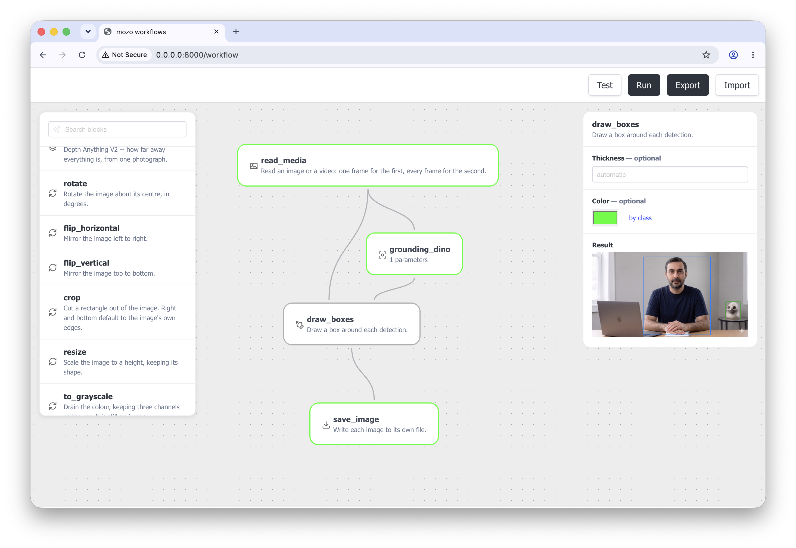

# Mozo

[](https://github.com/emrahnazif/mozo/actions/workflows/ci.yml)
[](https://pypi.org/project/mozo/)
[](https://pypi.org/project/mozo/)
[](LICENSE)

### 86 models, and the workflows that run them.

One `pip install`. No dependency hell. Runs models, executes workflows, and builds them.

Normally each of these models arrives with its own package, and each package brings its own
dependencies — torch, numpy and OpenCV, every one pinned to something slightly different. Put a
few in one environment and something breaks. The usual escape is a container per model, and
paying for that forever.

Mozo ships none of them. Every model's inference path is vendored into mozo itself and verified
**bit-identical** to the original implementation — so one environment runs all 86, and gives
you the original's exact numbers rather than something close.

```bash
pip install mozo
mozo start
```

No Docker, no Kubernetes, no per-model build step, no conversion step, no `git clone` of
anything.

Serve from one install, in one process, behind one API.

A model on its own is rarely the job. Detect, then blur the faces, then save — that is a
**workflow**, and mozo runs those too: as a graph you draw in the browser, a JSON file you keep in
version control, or one call from Python. Same models, same process, no extra install.

## Models

Grouped by what they do. Each name links to the model's page, with examples, every parameter and
how it behaves; [all models](docs/models/all-models.md) lists every variant with its download size.
A model is named `family/variant`, such as `rfdetr/medium`.

### Object detection

A box, a class and a confidence for each object.

| Model | Sizes | Licence | Runtimes |
|---|---|---|---|
| [RF-DETR](docs/models/rfdetr.md) | nano → large | Apache-2.0 | torch, onnx, coreml; tensorrt on CUDA |
| [Mayaku](docs/models/mayaku.md) | street-nano, street-medium | Apache-2.0 | torch, onnx, coreml; tensorrt on CUDA |
| [YOLOv8](docs/models/yolov8.md) | nano → xlarge | AGPL-3.0 | torch, onnx, coreml |
| [YOLO11](docs/models/yolov11.md) | nano → xlarge | AGPL-3.0 | torch, onnx |
| [YOLO12](docs/models/yolov12.md) | nano → xlarge | AGPL-3.0 | torch, onnx, coreml |
| [YOLO26](docs/models/yolov26.md) | nano → xlarge | AGPL-3.0 | torch, onnx |

### Instance segmentation

A box and a mask for each object, in one pass. Same call as detection: the `seg-` variants return
masks.

| Model | Sizes | Licence | Runtimes |
|---|---|---|---|
| [RF-DETR](docs/models/rfdetr.md) | nano → large | Apache-2.0 | torch, onnx, coreml; tensorrt on CUDA |
| [Mayaku](docs/models/mayaku.md) | street-seg-nano, street-seg-medium | Apache-2.0 | torch, onnx, coreml; tensorrt on CUDA |
| [YOLO11](docs/models/yolov11.md) | nano → xlarge | AGPL-3.0 | torch, onnx |
| [YOLO26](docs/models/yolov26.md) | nano → xlarge | AGPL-3.0 | torch, onnx |

### Keypoints

COCO's 17 joints for each person.

| Model | Sizes | Licence | Runtimes |
|---|---|---|---|
| [RF-DETR](docs/models/rfdetr.md) | preview | Apache-2.0 | torch |
| [ViTPose](docs/models/vitpose.md) | small → huge | Apache-2.0 | torch, onnx (not huge) |

### Detection from words

Boxes for anything you can name, instead of a fixed class list.

| Model | Sizes | Licence | Runtimes |
|---|---|---|---|
| [Grounding DINO](docs/models/grounding-dino.md) | tiny, base | Apache-2.0 | torch; fp16 and tensorrt on CUDA |
| [OWLv2](docs/models/owlv2.md) | base, large | Apache-2.0 | torch; fp16 and tensorrt on CUDA |
| [SAM 3](docs/models/sam3.md) | one | SAM License | torch, coreml |

### Segmentation from a click or a box

Point at something and get its mask.

| Model | Sizes | Licence | Runtimes |
|---|---|---|---|
| [SAM 2](docs/models/sam2.md) | tiny → large | Apache-2.0 | torch |
| [EdgeTAM](docs/models/edgetam.md) | one | Apache-2.0 | torch |
| [SAM 3](docs/models/sam3.md) | one | SAM License | torch, coreml |

### Classification from words, and image embeddings

Name your classes in words and score each against the image, or keep the vectors and search images
by text.

| Model | Sizes | Licence | Runtimes |
|---|---|---|---|
| [CLIP](docs/models/clip.md) | base, large | MIT | torch |
| [SigLIP 2](docs/models/siglip2.md) | base → giant | Apache-2.0 | torch |

### Text embeddings

English text in, one vector out, for searching documents by meaning.

| Model | Sizes | Licence | Runtimes |
|---|---|---|---|
| [Granite Embedding R2](docs/models/granite-embedding-r2.md) | small | Apache-2.0 | torch, coreml |

### Text recognition

Every line of text in the image, in five scripts; `latin` alone covers 41 languages.

| Model | Sizes | Licence | Runtimes |
|---|---|---|---|
| [EasyOCR](docs/models/easyocr.md) | one per script | Apache-2.0 | torch |

### Depth

A depth map at the image's resolution, in metres or relative.

| Model | Sizes | Licence | Runtimes |
|---|---|---|---|
| [Depth Anything V2](docs/models/depth-anything-v2.md) | small → large | Apache-2.0; CC-BY-NC-4.0 for relative base and large | torch |

### Background removal

A soft opacity matte for the foreground that keeps hair.

| Model | Sizes | Licence | Runtimes |
|---|---|---|---|
| [BEN2](docs/models/ben2.md) | base | MIT | torch |

### Object removal

An image and a mask in, the masked thing painted out.

| Model | Sizes | Licence | Runtimes |
|---|---|---|---|
| [Moebius](docs/models/moebius.md) | general, places2 | Apache-2.0 | torch |

## Install

```bash
pip install mozo
```

That is the whole install — twelve ordinary dependencies, not one of them a model package.

```bash
# Optional runtimes, for the families that publish those artifacts
pip install 'mozo[onnx]'     # onnxruntime
pip install 'mozo[coreml]'   # coremltools, macOS only
pip install tensorrt-cu12    # or -cu13, matching your torch's CUDA; TensorRT 11 or later
```

No family needs an extra. The extras add *ways to execute* a model, not models: without them
`runtime="auto"` simply does not select those artifacts. TensorRT is not an extra because its
wheel has to match your torch's CUDA version; [Runtimes](docs/deployment/runtimes.md#tensorrt)
says which one to install and which models use it.

## Using it

Three interfaces over the same models, plus two browser pages.

| | |
|---|---|
| **HTTP server** | serve models to other machines, or to a language that is not Python |
| **Python API** | build a pipeline, a script or a notebook, in-process |
| **Workflows** | wire models and image operations into a graph, and run it headless |
| *Workflow editor* | draw the graph, run it, watch each node finish |

### 1. HTTP server

```bash
mozo start
```

```bash
curl -X POST "http://localhost:8000/predict/rfdetr/medium" -F "file=@street.jpg"
```

```json
[
  {"bbox": [0.0, 113.24, 763.19, 1269.33], "class_name": "person", "confidence": 0.917},
  {"bbox": [709.0, 773.0, 1366.0, 1143.0], "class_name": "laptop", "confidence": 0.854}
]
```

Trimmed for reading. The real response carries every PixelFlow field on every detection —
`masks`, `segments`, `text`, `class_id`, `metadata` and the rest — including the ones that are
`null`, because `masks: null` beside a filled `segments` is a difference worth being able to see.

The catalogue is answerable without loading anything:

```bash
curl http://localhost:8000/models          # all 86, no torch import, no weights
curl http://localhost:8000/models/loaded   # what is resident right now
```

Every route and parameter is in the [HTTP API reference](docs/reference/http-api.md), and the
server documents itself at `http://localhost:8000/docs`.

### 2. Python API

```python
import mozo

model = mozo.get_model("rfdetr/medium")

for found in model.predict("street.jpg"):
    print(found.class_name, found.confidence, found.bbox)
#   person 0.92 [0.0, 113.24, 763.19, 1269.33]
#   laptop 0.85 [709.0, 773.0, 1366.0, 1143.0]
```

`predict` takes a path, encoded bytes, or an RGB array, and returns a unified PixelFlow `Detections` —
iterable, indexable, and the same shape from every family here.

```python
# Ask for something in words
model = mozo.get_model("owlv2/base-ensemble")
found = model.predict("kitchen.jpg", ["kettle", "a mug", "the window"])
found[0].class_name          # 'kettle' — the phrase you searched for

# Read the text on a sign
model = mozo.get_model("easyocr/english")
found = model.predict("sign.jpg")
found[0].text                # 'EXIT 42' — what it says
found[0].class_name          # None — OCR reads content, it does not pick a class

# Measure depth
model = mozo.get_model("depth_anything_v2/indoor-small")
depth = model.predict("room.jpg")    # HxW float32, at the input's resolution
model.unit                           # 'metres' — or None, and then it is not a distance
```

### 3. Workflows

A workflow is a graph of nodes in a JSON file. Draw it at `/workflow`, or write it by hand; run it
from Python, from the command line, or over HTTP. The editor also mounts into a page of your own,
and the routes into your own FastAPI app — see
[docs/workflows/editor.md](docs/workflows/editor.md#put-the-editor-in-your-own-app).



```python
from mozo.workflow import Workflow

results = Workflow.load("blur_faces.json").run(source="street.jpg")
```

```bash
mozo run blur_faces.json --file street.jpg
```

51 nodes: every model family that answers about an image, SAM 2, EdgeTAM and SAM 3 segmenting the boxes another node found, RF-DETR
from a checkpoint of your own, tracking objects across a video's frames, the image transforms and
annotations PixelFlow provides, and the ends that read images and annotations and write results. A
node is an ordinary Python function — its signature *is* its
declaration, so what the editor offers you and what actually runs cannot disagree:

```python
@node(category="Annotate")
def draw_boxes(image: Image, detections: Detections, thickness: int | None = None) -> Image:
    """Draw a box around each detection."""
    return pf.annotate.box(image.copy(), detections, thickness=thickness)
```

Connections are typed. A port carrying detections cannot be wired into one that takes an image, and
the editor refuses it before anything runs. Adding a node is adding a function.

## Verification

Vendoring a model normally means maintaining something that quietly drifts from the original. The
whole claim above rests on that not happening, so it is checked rather than asserted — **with no
tolerance.** Exact equality, because a tolerance hides precisely the drift a check exists to catch.

The gates in `tools/verify/` compare every intermediate stage against the original implementation,
not just the final answer: 1,275 comparisons for EasyOCR, 226 for OWLv2, 138 for Grounding DINO,
every one identical. Sixteen of the nineteen families ship one; all nineteen have their parity measured
and recorded in
`mozo/vendors/<family>_deploy/PROVENANCE.md`, with the upstream commit it was built from.

Because the extraction *is* the implementation rather than a wrapper around one, none of this
costs anything at run time: EasyOCR runs within 1% of the published package on the same weights.

## Documentation

Everything below the surface is at **[emrah.fr/mozo](https://emrah.fr/mozo/)**, written in
[`docs/`](docs/index.md) in this repository:

| | |
|---|---|
| [Installation](docs/installation.md) | CUDA, Apple silicon, the ONNX and CoreML runtimes, where weights are cached |
| [Python](docs/python.md) | loading models, reading and drawing results, memory, your own checkpoints |
| [HTTP server](docs/server.md) | serving models, what comes back, prepared images for interactive clicks |
| [Models](docs/models/all-models.md) | one page per family: examples, every parameter, how it behaves and why |
| [Workflows](docs/workflows/editor.md) | the editor, every node, running over videos and folders, writing a node |
| [Deployment](docs/deployment/production.md) | configuration, production, runtimes, verification, licences |
| [Reference](docs/reference/python-api.md) | every public function, route and command |

**The docs ship with the package**, so they always match the version you installed and need no
network: the pages are markdown files in `mozo/docs/`, with an index for coding agents at
`mozo/docs/llms.txt` that lists every page with a one-line summary. To find the folder:

```bash
python -c "import importlib.util, os; print(os.path.dirname(importlib.util.find_spec('mozo').origin) + '/docs')"
```

## What mozo does not do

- **No training and no fine-tuning.** Bring a checkpoint; mozo runs it.
- **It is not a model hub.** The catalogue is a curated 86, chosen because each one could be
  extracted and verified. Growth is deliberate and slow.

## Extending

A workflow node is one Python function: [Write a node](docs/workflows/writing-nodes.md). A new model
family is vendored, verified and published by the process in [VENDORING.md](VENDORING.md); the rule
that keeps it honest is that **a vendor imports no other vendor and never imports mozo**, which
`tests/test_vendor_agreement.py` enforces.

## Development

```bash
pip install -e .
mozo start --reload
pytest
```

The workflow editor is a Svelte app in `ui/`. Its build output is committed, so npm is needed to
*change* it and never to install mozo:

```bash
cd ui && npm install && npm run build   # writes mozo/workflow/static/assets/
```

## Links

- [Documentation](https://emrah.fr/mozo/)
- [Repository](https://github.com/emrahnazif/mozo)
- [Issues](https://github.com/emrahnazif/mozo/issues)
- [PixelFlow](https://github.com/emrahnazif/pixelflow) — the result format

## License

Mozo's own code is **Apache-2.0**, and so is every vendored extraction under `mozo/vendors/`.

The weights are separate works travelling with it. Of the 86 published variants, **48 are
Apache-2.0**, 30 are **AGPL-3.0** (every YOLO variant), 5 are **MIT** (CLIP and BEN2), 2 are
**CC-BY-NC-4.0** (Depth Anything `base` and `large`), and 1 carries Meta's **SAM License**
(SAM 3). The full licence and a NOTICE
naming the exact upstream release are published beside every checkpoint.

Which licence a variant is under can be asked before anything is downloaded:
`mozo.weights.license_of("yolov8", "nano")` returns `"AGPL-3.0"`, and `GET /models` carries
the same identifier for every variant it offers.

**YOLO weights are AGPL-3.0**, or covered by a commercial licence from Ultralytics.
And serving predictions from them over a network places  AGPL-3.0 section 13 obligations on you.

Complying with either is the operator's responsibility. `MOZO_ENABLE` is how an instance declines
to take it on — a server that never offers a model never fetches or serves its weights:

```bash
MOZO_ENABLE=ben2,clip,easyocr,edgetam,granite_embedding_r2,grounding_dino,mayaku,moebius,\
owlv2,rfdetr,sam2,siglip2,vitpose,depth_anything_v2/small,depth_anything_v2/indoor-small,\
depth_anything_v2/indoor-base,\
depth_anything_v2/indoor-large,depth_anything_v2/outdoor-small,\
depth_anything_v2/outdoor-base,depth_anything_v2/outdoor-large
```

That is the 53 Apache-2.0 and MIT variants, and it stays 53 through an upgrade that adds
families — which a list of what to *exclude* would not. Depth Anything is named variant by variant
because it is the one family whose licence is not uniform: seven of its nine are Apache-2.0 and
two are CC-BY-NC-4.0.

Nothing here relicenses anything. It only decides what one deployment hands out.
