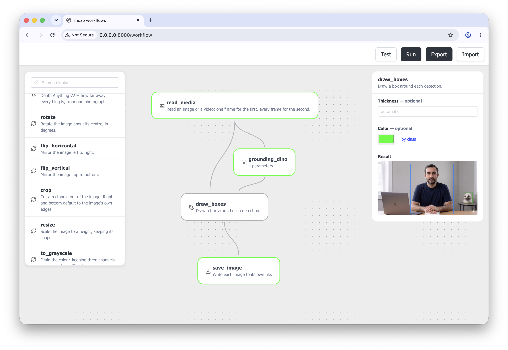

# Build a workflow in the editor

<!--
summary: Chain models and image operations into a workflow: draw it in mozo's browser editor, keep it as JSON, and embed the editor in your own app.
label: Editor
keywords: mozo, workflow, workflow editor, node graph, pipeline, computer vision pipeline
-->

A model on its own is rarely the job. Find the faces, blur them, save the picture: that is a
workflow. In mozo a workflow is a graph of nodes saved as a JSON file. You draw it in the browser,
keep it in version control, and run it from Python, the command line or over HTTP, with the same
models and nothing extra to install.



## Open the editor

```bash
mozo start
```

Then open `http://localhost:8000/workflow`. The palette on the left lists every node by category.
Drag nodes onto the canvas, connect an output to an input, and set each node's parameters in the
panel. **Test** runs the graph on one image and shows every node's output; **Run** runs it over
everything its source produces, such as every frame of a video. **Export** saves the workflow as a
JSON file, and **Import** opens one.

[Nodes](/docs/workflows/nodes.md) lists all 50 nodes with their inputs, outputs and parameters.

## What a workflow is

This workflow finds faces with Grounding DINO, blurs them, and saves the result:

```json
{
  "name": "Blur faces",
  "description": "Find every face and blur it.",
  "nodes": [
    {"id": "read", "type": "read_media", "data": {"parameters": {"source": "example.jpg"}}},
    {"id": "find", "type": "grounding_dino",
     "data": {"parameters": {"text": ["face"], "variant": "tiny", "threshold": 0.3}}},
    {"id": "blur", "type": "blur_regions", "data": {"parameters": {}}},
    {"id": "save", "type": "save_image", "data": {"parameters": {"path": "blurred"}}}
  ],
  "edges": [
    {"source": "read", "sourceHandle": "image", "target": "find", "targetHandle": "image"},
    {"source": "read", "sourceHandle": "image", "target": "blur", "targetHandle": "image"},
    {"source": "find", "sourceHandle": "detections", "target": "blur", "targetHandle": "detections"},
    {"source": "blur", "sourceHandle": "image", "target": "save", "targetHandle": "image"}
  ]
}
```

```bash
mozo run blur_faces.json
```


A node has an `id`, a `type` (the node's name) and its `parameters`. An edge connects one node's
output port to another's input port. The editor also writes each node's `position` on the canvas.
`name` and `description` are optional, and are what someone choosing between workflows reads.

## Connections are typed

Every port has a type, and a connection is only allowed between ports of the same type. The editor
refuses a wrong connection before anything runs.

| Type | Carries |
|---|---|
| `image` | an `HxWx3` RGB `uint8` array (`HxWx4` where a node takes an alpha channel) |
| `detections` | a PixelFlow `Detections`: boxes, masks, keypoints, read text |
| `classifications` | a PixelFlow `Classifications`: scores with no boxes |
| `depth` | a float depth map with its range |

`classifications` is separate from `detections` because a `Classifications` has no boxes: one type
for both would let the editor offer a connection that fails as soon as it runs. `depth` is separate
from `image` because a depth map is a measurement, and flattening it to eight bits would throw the
metres away.

A workflow is either valid or it does not load. Loading checks that every connection names ports
that exist, that the types on both ends agree, that every input is fed exactly once, and that the
graph has no cycle. So a workflow that loaded does not fail halfway through for a structural reason,
with a model already on the GPU. Every way a file can fail raises one error,
`mozo.workflow.WorkflowError`, with a message that says what is wrong:

```text
find.detections is detections, but blur.image takes image
```

**One node runs over many images by itself.** When a list arrives on an input, the node runs once
per item and the results are collected. `crop_around_detections` turns one image into one per
detection, and every node after it then runs on each crop. Lists of different lengths are refused,
not padded.

## Put the editor in your own app

The workflow routes come from `workflow_router()`. `mozo start` mounts one whose model loads are held
to `MOZO_ENABLE`. Your own FastAPI application can mount its own, under any prefix, with your own way
of loading models:

```python
from fastapi import FastAPI
from mozo import ModelManager
from mozo.workflow.api import workflow_router

app = FastAPI()
manager = ModelManager()

app.include_router(workflow_router(models=manager.get_model, process=False), prefix="/mozo")
```

- `models` is how model nodes load their models: a `ModelManager`'s `get_model`, or any function
  shaped like it. Without it, nodes load through mozo's shared cache, a second copy beside yours.
- `process=False` leaves out whole-source runs, for an application that runs workflows as its own
  jobs. The editor then offers **Test** and not **Run**.

The editor is then at `/mozo/workflow`. It finds its files and its API from where it was served, so
the prefix needs no configuration. `/mozo/workflow?toolbar=0` hides its toolbar.

To put the editor inside a page of your own, mount it into an element:

```html
<div id="editor" style="height: 600px"></div>
<script type="module">
  import { mount } from "/mozo/workflow/assets/editor.js";

  const editor = mount(document.querySelector("#editor"), { document: saved, toolbar: false });
  editor.on("change", () => markUnsaved());
  saveButton.onclick = () => save(editor.getDocument());
  testButton.onclick = async () => show(await editor.test(file));
</script>
```

| Call | What it does |
|---|---|
| `mount(element, {document, toolbar, base})` | Draws an editor filling `element`. `document` opens a workflow, `toolbar: false` leaves the buttons to you, `base` points at a router mounted elsewhere. |
| `getDocument()` / `setDocument(document)` | Reads or replaces the workflow on the canvas. Setting one is not a change. A connection to a missing node or port is left out, and the editor says which. |
| `on("change", listener)` | Calls `listener` with the document whenever the person changes it, once a drag ends rather than during it. Returns a function that stops listening. |
| `test(file)` | Tests on a file, or on the one chosen on the input node. Resolves to every node's output. |
| `destroy()` | Removes the editor from the page. |

The editor mounts in a shadow root, so its styles cannot reach your page and yours cannot reach it.
Restyle it through its CSS variables, set on the element you mounted it into: `--mz-color-bg`,
`--mz-color-text`, `--mz-font-sans`, `--mz-radius-md` and the rest in mozo's
`ui/src/styles/editor.css`. `color-scheme: dark` on that element turns it dark. Nodes your
application registers appear in its palette, because the palette is the node registry.

## What it cannot do yet

- **Zones**, and **clicks** for SAM 2, EdgeTAM and SAM 3. Both are pixel coordinates, and the editor
  has no way to draw one yet. Boxes work: `sam2_boxes`, `edgetam_boxes` and `sam3_boxes` add masks
  to the boxes another node found. For clicks, call the model from
  [Python](/docs/models/sam2.md).
